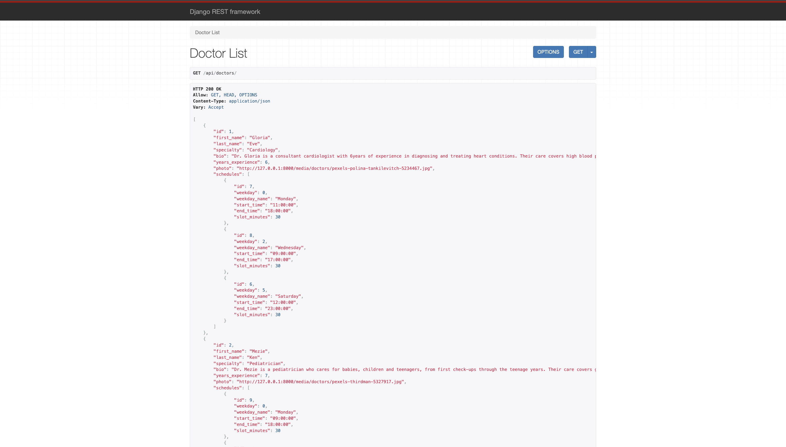
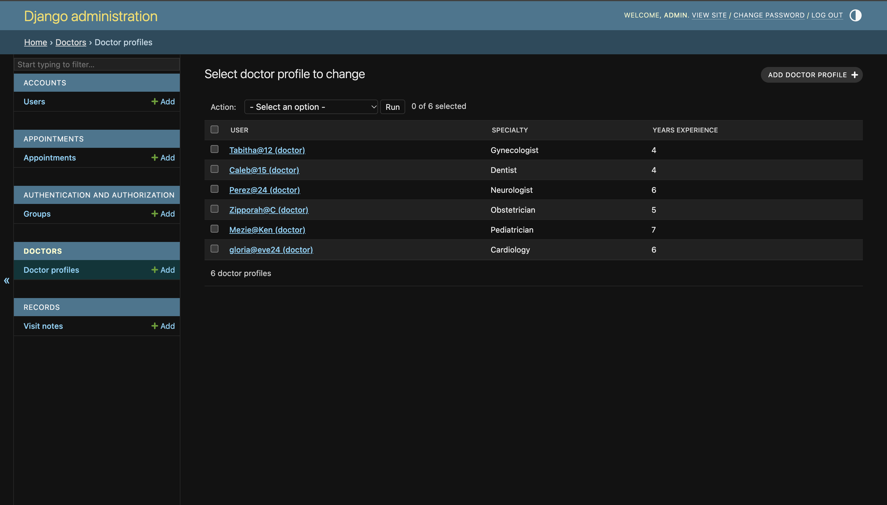

# St Eves Appointment Booking API

The backend for **St Eves**, a medical appointment booking system. Patients book appointments with doctors, doctors manage their schedules and write visit notes, and staff help run the clinic.

The website that uses this API is in a separate project: [st-eves-frontend](https://github.com/eve-beep-ij/st-eves-frontend).

## Screenshots

The doctors list, as the API returns it:


The Django admin panel, where staff manage doctors:



## What it does

- **Accounts and roles:** register and log in. There are three roles: patient, doctor and staff. Each role sees only what it is allowed to see.
- **Doctors:** a list of doctors with their specialty and photo.
- **Doctor schedules:** doctors set their working days and hours. A day with upcoming appointments cannot be deleted.
- **Booking:** patients choose a doctor and a free time slot. Booked slots cannot be booked twice.
- **Appointment management:** patients can cancel or reschedule. Doctors can confirm, cancel or complete an appointment, and cannot complete one before its date.
- **Visit notes and prescriptions:** doctors write notes and medicines for completed appointments. Patients can read only their own.
- **Patient profile:** patients can view and edit their own details.
- **Video calls:** confirmed appointments get a private, hard-to-guess video room code.
- **Email notifications:** emails for booked, confirmed, cancelled and rescheduled appointments, plus a reminder command.
- **Privacy rules:** patients cannot see or change another patient's data, and staff cannot read medical notes.

## Built with

- Python and Django
- Django REST Framework
- Simple JWT (login tokens)
- MySQL
- django-cors-headers
- Pillow (doctor photos)
- python-dotenv (secret settings)

## Project structure

| Folder | What it holds |
| --- | --- |
| `core` | Project settings and main URLs |
| `accounts` | Users, roles, register, login, profile |
| `doctors` | Doctor profiles and working schedules |
| `patients` | Patient details |
| `appointments` | Booking, cancelling, rescheduling, status changes, reminders |
| `records` | Visit notes and prescriptions |
| `notifications` | Email helper |

## How to run it on your computer

You need Python 3 and MySQL installed.

**1. Download the project**

```
git clone https://github.com/eve-beep-ij/st-eves-api.git
cd st-eves-api
```

**2. Create and start a virtual environment**

```
python3 -m venv env
source env/bin/activate
```

**3. Install the requirements**

```
pip install -r requirements.txt
```

**4. Create the MySQL database**

In MySQL, create a database called `clinic_db` and a user that can use it.

**5. Create a `.env` file**

Create a file called `.env` in the project folder (next to `manage.py`) and fill in your own values for the secret key and the database details. Use the same names that `core/settings.py` reads. Never share this file or upload it to GitHub.

**6. Set up the database tables**

```
python manage.py migrate
```

**7. Create an admin user (optional)**

```
python manage.py createsuperuser
```

**8. Start the server**

```
python manage.py runserver
```

The API now runs at `http://127.0.0.1:8000/`.

## Useful commands

Run the tests:

```
python manage.py test appointments
```

Send appointment reminder emails:

```
python manage.py send_reminders
```

While developing, emails are printed in the terminal instead of being sent.

## Notes

- Doctor photos are saved in a `media` folder, which is not uploaded to GitHub.
- The `.env` file, the `env` folder and the local database file are also kept out of GitHub on purpose.

## Author

**Gloria Eve**, full-stack developer.